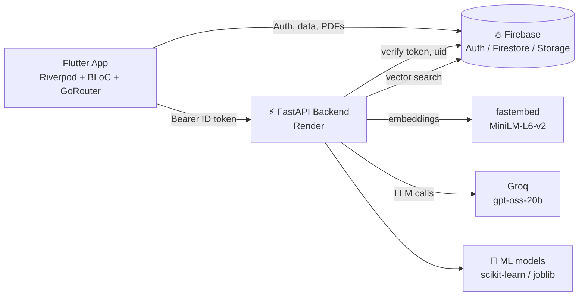
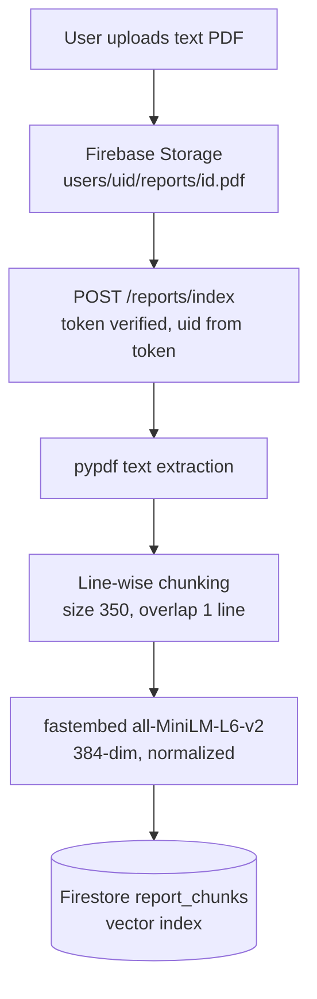
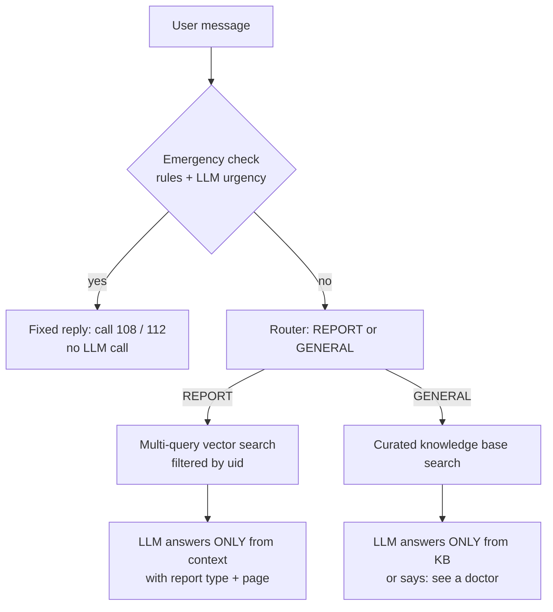

<div align="center">

# 🩺 Swasth Setu

### A bridge to better health: book doctors, skip the queue, and understand your reports with a safe AI assistant.


*Status: in development, Play Store closed testing planned*

</div>

---

## ✨ What is Swasth Setu?

Patients lose hours in hospital queues and often cannot understand their lab reports or health information, especially in Hindi and Hinglish. **Swasth Setu** brings appointment booking, a live OPD queue, emergency help and a *safety-first* AI assistant into one app.

> ⚠️ **Disclaimer:** Swasth Setu gives general health information only. It is **not** a medical device, does not diagnose, never suggests medicines or doses, and is not an emergency service. In an emergency call **108 / 112**.

---

## 📱 Features

| | Feature | Details |
|---|---|---|
| 👨‍⚕️ | **Doctor search & booking** | Search by name, specialty or symptoms in **English, Hindi or Hinglish** ("pet dard", "chest pain") |
| 🎟️ | **Live OPD queue & tokens** | See your token and how close your turn is, without waiting in the hospital |
| 🆘 | **SOS** | Quick emergency help and helpline access |
| 🏥 | **Hospitals** | Find hospitals and book from the app |
| 📄 | **Health Records** | Upload text-based PDF lab reports (with consent) |
| 💬 | **AI Assistant (RAG)** | Ask questions about *your own* reports and get answers with **report name and page number** |
| 📚 | **Health knowledge base** | General health questions answered from a curated set of 12 sources, with source links |
| 🧠 | **ML risk screening** | Heart disease, diabetes and symptom-based disease models |

---

## 🏗️ Architecture



---

## 🤖 The AI assistant (RAG)

### Report Q&A pipeline



### How a question is answered



### 🛡️ Safety by design

- 🚨 **Emergency detection runs before any LLM call** (rule-based keyword net + existing urgency rules + LLM urgency).
- 🚫 **No diagnosis, no medicines or doses, no "normal / abnormal" judgement.** The assistant only repeats values found in your report.
- 🔒 **Per-user isolation:** the `uid` always comes from the verified Firebase ID token, and every vector search is filtered by it. The `report_chunks` collection is blocked for client apps and reachable only through the backend.
- 📎 **Sources shown** with every answer (report + page, or a link for knowledge base answers).
- ✅ **Consent dialog** before the first report upload.
- 🌐 **Language follows the user:** Devanagari Hindi, Hinglish (Roman) or English.

### 📊 Evaluation (honest numbers)

| Test set | Result |
|---|---|
| 20 hand-made questions (report Q&A, general health, out-of-scope, no-medicine, safety checks) | **17 / 20 correct** |

Failures were mostly questions asking for **exact lab values** (for example a platelet count), caused by weak retrieval on short numeric lines. Planned fix: **hybrid (keyword + vector) search** and better table parsing.

> This is a small, hand-made test set, not a clinical benchmark. Run it yourself: `python -m app.rag.run_eval`

---

## 🧪 ML models

All three models were trained in Google Colab, compared with 5-fold stratified cross-validation, tuned with `GridSearchCV`, and saved with `joblib` plus a `meta_*.json` file (feature order, threshold, cleaning rules, sklearn version).

| Model | Data | Final algorithm | Notes |
|---|---|---|---|
| ❤️ Heart disease | 1,025 rows → **302 unique** | Logistic Regression (C=0.3) | Threshold **0.30** for higher recall; inverted target in source file handled |
| 🩸 Diabetes | Pima, 768 rows | Logistic Regression (C=1) | Threshold **0.35**: recall 0.50 → 0.69 on the test set |
| 🤒 Disease from symptoms | 4,920 rows → **304 unique**, 41 diseases, 131 symptoms | Logistic Regression (C=100) | Returns **top-3** diseases; stress-tested with symptoms randomly dropped |

**Lessons built in:** duplicates removed *before* splitting to stop data leakage, invalid values (`ca=4`, `thal=0`, zeros in Pima) treated as missing, and thresholds chosen on training cross-validation, not on the test set.

---

## 🧰 Tech stack

| Layer | Technology |
|---|---|
| **Mobile** | Flutter, Dart, Riverpod, BLoC, GoRouter |
| **Cloud** | Firebase Auth, Cloud Firestore (with vector search), Firebase Storage |
| **Backend** | Python, FastAPI, Uvicorn, hosted on Render |
| **AI** | Groq (`openai/gpt-oss-20b`), fastembed (`all-MiniLM-L6-v2`), pypdf |
| **ML** | scikit-learn, pandas, NumPy, XGBoost (comparison), joblib |

---

## 🗂️ Backend structure

```text
app/
├── main.py                 # FastAPI app, includes routers
├── core/
│   ├── firebase.py         # Firebase Admin init
│   └── auth.py             # ID token verification
├── routers/
│   ├── reports.py          # POST /reports/index, DELETE /reports/{id}
│   └── chat.py             # POST /chat (router only)
├── search/                 # Doctor search: rules.py, understand.py, specialties.py
└── rag/
    ├── chat.py             # Main chat logic (emergency, router, REPORT / GENERAL)
    ├── chunking.py
    ├── embedder.py
    ├── report_search.py    # Firestore vector search over report chunks
    ├── kb_search.py        # Knowledge base search
    ├── build_kb.py         # Builds kb_index from app/rag/kb/*.txt
    ├── kb/                 # Curated knowledge base (12 topics)
    ├── kb_index/           # vectors.npy + chunks.json
    └── run_eval.py         # 20-question evaluation
```

---

## 🚀 Getting started

### 1. Backend

```powershell
git clone https://github.com/harshitvats27/<your-repo-name>.git
cd <your-repo-name>

python -m venv .venv
.venv\Scripts\activate
pip install -r requirements.txt
```

Create a `.env` file (never commit it):

```env
GROQ_API_KEY=your_groq_key
FIREBASE_SERVICE_ACCOUNT_JSON={"type": "service_account", ...}   # one line
FIREBASE_STORAGE_BUCKET=your-project.appspot.com
FIRESTORE_DATABASE_ID=default
```

Build the knowledge base index and run the server:

```powershell
python -m app.rag.build_kb
uvicorn app.main:app --reload
```

> **Firestore vector index:** create a composite index on `report_chunks` with `uid` (ascending) and `embedding` (vector, dimension **384**, flat) for your database.

### 2. Flutter app

```powershell
flutter pub get
flutterfire configure     # connect your own Firebase project
flutter run
```

Point the app's API base URL at your running backend.

### 3. Evaluate

```powershell
python -m app.rag.run_eval
```

---

## ⚠️ Known limitations

- Only **text-based PDFs** are supported. Scans and photos need OCR (future work).
- The emergency keyword net is **incomplete**; the assistant is not an emergency service.
- The knowledge base covers only **12 topics**.
- The evaluation set is small and hand-made; exact lab-value questions are the weakest area.
- Hinglish detection uses a word list.
- The ML models are trained on public, partly synthetic datasets. They are **screening and learning aids, not diagnosis tools.**
- Free-tier hosting means a **30–60 s cold start** on the first request.

---

## 🗺️ Roadmap

- [ ] Hybrid keyword + vector search for exact lab values
- [ ] OCR for scanned reports
- [ ] Multilingual embeddings for Hindi reports
- [ ] Larger, independent evaluation set and retrieval metrics (recall@k, MRR)
- [ ] Stronger multilingual emergency detection
- [ ] Restrict CORS to known origins and add rate limiting
- [ ] Play Store release

---

## 📸 Screenshots

<!-- Add your screenshots to a /screenshots folder and replace the paths below -->

| Home | Doctor search | Live queue | AI assistant |
|:---:|:---:|:---:|:---:|
|  |  |  |  |

---

## 👨‍💻 Author

**Harshit Vats**, final-year B.Tech CSE, VIT Bhopal University

[](https://github.com/harshitvats27)
[](https://www.linkedin.com/in/harshit-vats-aa820728a)

---

<div align="center">

⭐ If you find this project useful, consider giving it a star.

</div>
